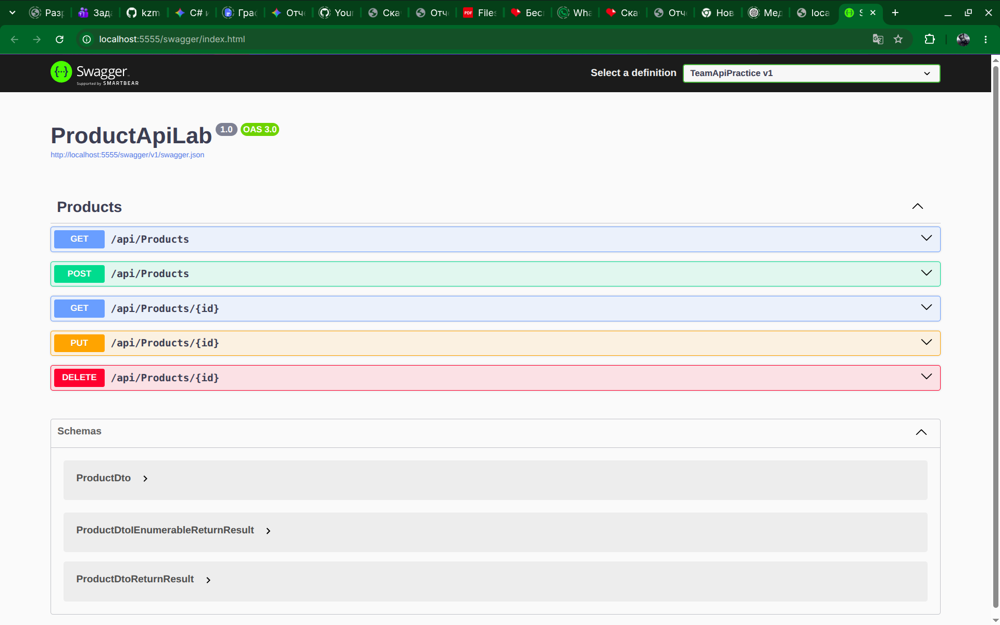
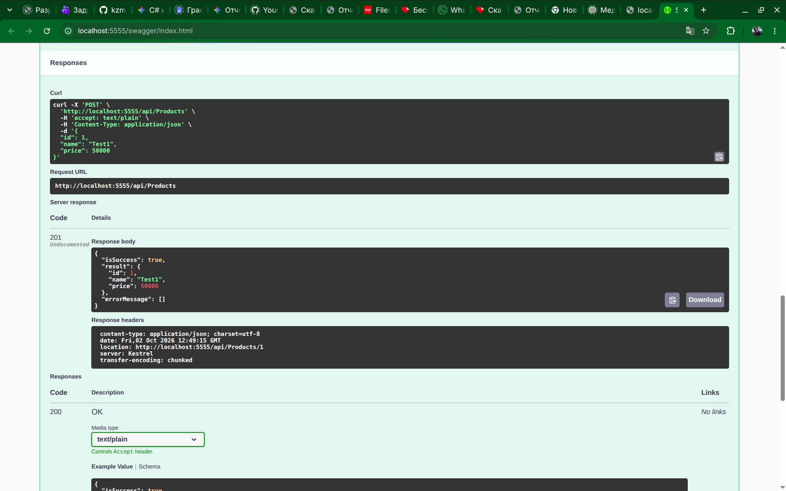
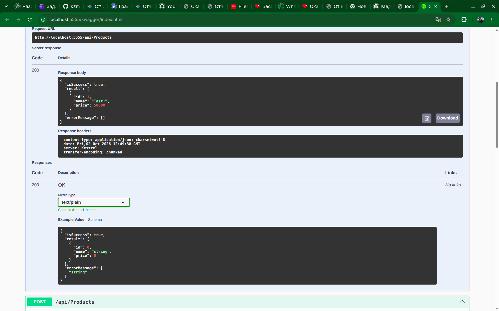
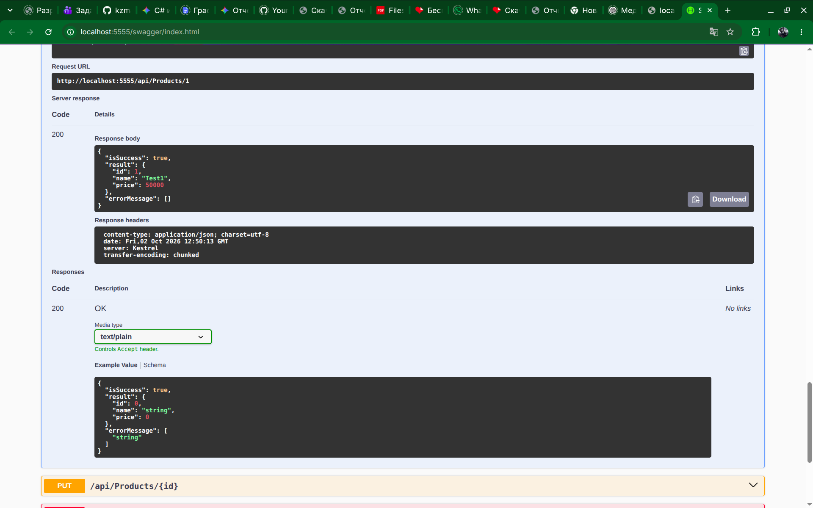
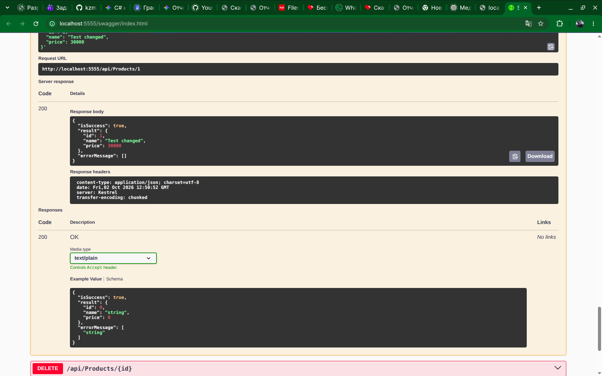
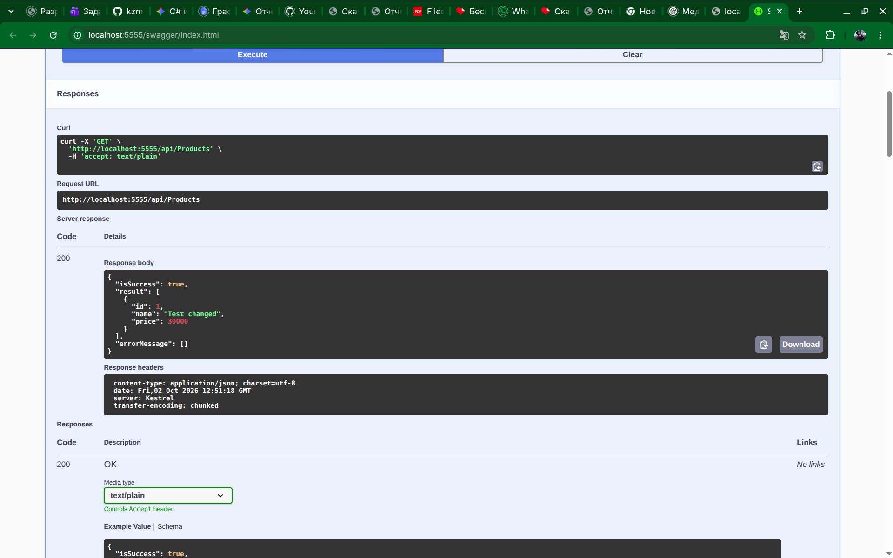
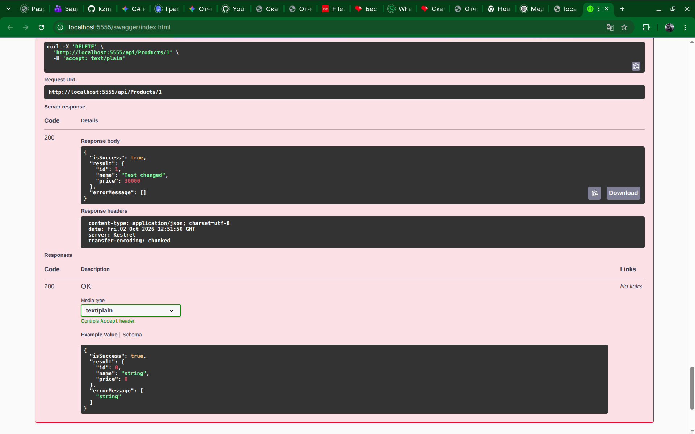
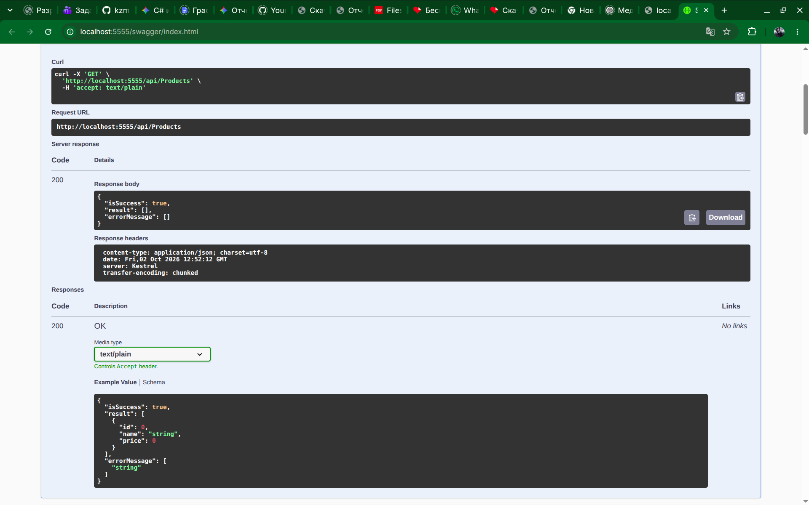

# Ткачев Максим
# Лабораторная работа: Модуль 04

## Тема
Модуль 04 DTO и AutoMapper Репозиторий с использование EF Core.

## Цель работы
Научиться создавать слой доступа к данным в ASP.NET Core Web API с использованием Entity Framework Core, шаблона Repository, DTO и AutoMapper.

## Описание реализации
В ходе выполнения работы был разработан Web API для управления товарами (Product). В рамках архитектуры приложения были реализованы следующие компоненты:
* Подключен Entity Framework Core и настроено подключение к базе данных через файл конфигурации `appsettings.json`.
* Создан класс `AppDbContext`, который унаследован от `DbContext` и содержит свойство `DbSet<Product> Products` для работы с сущностями товаров.
* С использованием подхода Code First была сгенерирована база данных посредством миграций.
* Создан интерфейс `IProductRepository` и его реализация в классе `ProductRepository` для инкапсуляции логики работы с базой данных.
* Разработан объект передачи данных `ProductDto`, в котором намеренно исключено поле `Category`, чтобы продемонстрировать отличие внутренней сущности от структуры, возвращаемой клиенту.
* Подключена библиотека AutoMapper и создан профиль конфигурации с использованием конструкции `CreateMap<Product, ProductDto>().ReverseMap()`.
* Создан `ProductsController`, в котором реализованы все основные CRUD-операции: получение списка, получение по идентификатору, создание, изменение и удаление.
* Для всех ответов API применен единый стандартизированный формат `ReturnResult`, обеспечивающий предсказуемую структуру JSON.

Итоговая архитектура полностью соответствует требуемой цепочке: Database → EF Core → Repository → AutoMapper → DTO → Controller → API Response.

## Результаты работы (Скриншоты)

### 1. Интерфейс Swagger

### 2. Создание товара (POST)

### 3. Получение всех товаров (GET)

### 4. Получение товара по ID (GET {id})

### 5. Обновление товара (PUT)

### 6. Проверка списка после обновления

### 7. Удаление товара (DELETE)

### 8. Проверка списка после удаления

